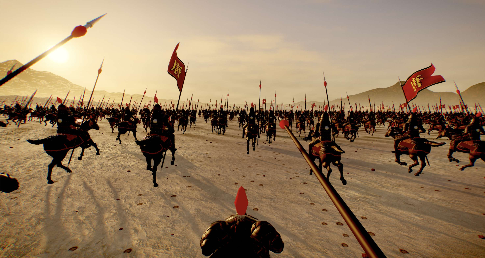

<div align="center">

# 🌍 World-By-Code

**用代码创造世界**

*程序员 Carl 的实时渲染作品集*

---

[](./LICENSE.md)
[]()
[]()

</div>

---

## 💡 项目理念

这里是我（程序员 Carl）创作的一系列实时渲染作品：山川、战场、城池、天象。

每个作品都是**可在本地直接运行的独立项目**，画面由代码实时渲染而成——不是视频，也不是预先渲染的图片。

**创作方式：** 我使用 AI（Claude Fable 5.2 + Claude Code）作为编程工具，提出构想、设计细节、迭代优化。代码全部开源，欢迎下载体验，也欢迎基于此继续创作。

---

## 🎨 作品展示

| 作品 | 简介 | 技术栈 |
| :--- | :--- | :--- |
| [🏜️ **大漠铁骑**](./desert-cavalry/) | 河西走廊，日暮。第一人称骑在战马上，与上千骑大唐铁骑一起冲锋的 20 秒实时 3D 演出 | Three.js · WebGL2 · GLSL · Web Audio · Vite |

<div align="center">

[](./desert-cavalry/)

*点击图片查看详情*

</div>

> 💎 更多作品正在创作中，敬请期待...

---

## 🚀 快速开始

每个作品是独立的可运行项目，互不依赖。进入任一作品目录，按其 README 说明操作即可。

### 示例：运行「大漠铁骑」

```bash
# 1. 克隆仓库
git clone https://github.com/youngyangyang04/world-by-code.git

# 2. 进入作品目录
cd world-by-code/desert-cavalry

# 3. 安装依赖
npm ci

# 4. 启动开发服务器
npm run dev

# 5. 在浏览器中打开
# 访问 http://127.0.0.1:5173
```

### 环境要求

- **Node.js**: 20.19 或更高版本
- **浏览器**: 支持 WebGL2 的现代桌面浏览器（Chrome、Firefox、Edge、Safari）

---

## 📁 仓库结构

```
world-by-code/
├── README.md                 # 本文件
├── LICENSE.md                # 许可证说明
└── desert-cavalry/           # 🏜️ 大漠铁骑
    ├── README.md             # 效果展示、启动说明、部署指南、技术实现
    ├── ASSETS.md             # 外部素材来源、作者、许可证信息
    ├── package.json          # 项目依赖
    ├── src/                  # 源代码
    └── public/               # 静态资源
```

### 📋 作品目录规范

每个作品遵循统一的组织约定：

- ✅ **独立可运行** - 自带完整依赖（`package.json` + 锁文件），不依赖其他作品
- 📖 **完善文档** - 包含效果展示、启动方法、部署指南
- 🔖 **素材溯源** - 外部资源在 `ASSETS.md` 中注明作者、许可证、来源链接
- 🎯 **如实陈述** - 明确标注过渡方案、未测试功能及已知限制

---

## 📜 开源许可

### 代码许可

本仓库代码采用 [PolyForm Noncommercial 1.0.0](./LICENSE.md) 许可证：

- ✅ **允许**：学习、修改、非商业使用
- ⚠️ **商业使用需申请商用许可**

商用授权联系方式详见 [LICENSE.md](./LICENSE.md)

### 素材许可

各作品使用的外部素材（模型、贴图、音频等）遵循原作者的许可证，详见各作品目录下的 `ASSETS.md`。

> ⚠️ **重要提示**：部分素材带有使用限制（例如：大漠铁骑的战马模型为 CC BY-ND 4.0），二次发布或商用前请务必核对许可条款。

---

## 🤝 支持与反馈

- ⭐ **觉得有意思？** 给项目点个 Star
- 💭 **有想看的场景？** 欢迎提 Issue 分享你的想法
- 🐛 **发现问题？** 通过 Issue 告诉我

---

<div align="center">

**World-By-Code** - 用代码创造世界

*Made by programmer Carl with ❤️ and AI*

</div>
