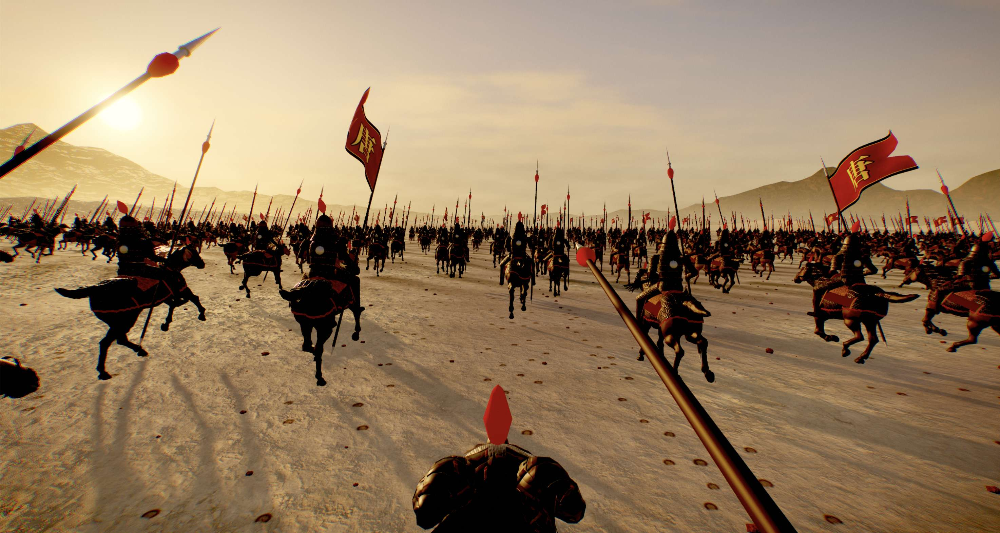
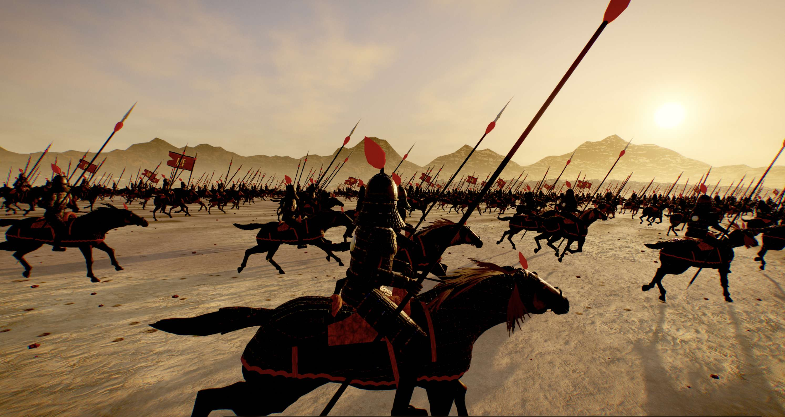
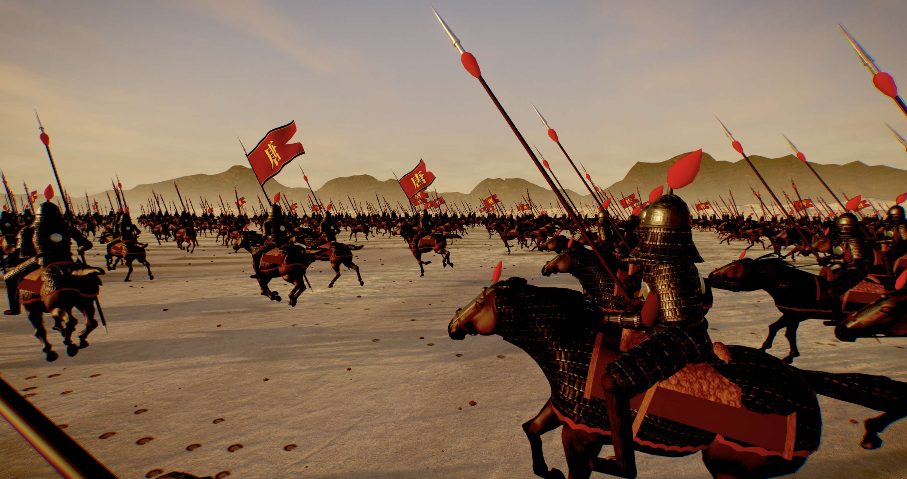

# 大漠铁骑 · 第一人称冲锋

> [world-by-code](../README.md) 的第一个作品。

河西走廊，日暮。你骑在战马上，身边是 20 名重甲近卫，外围是上千骑的大唐军阵，一起向落日冲锋。

这是一段 20 秒、可循环的第一人称实时 3D 演出，用 Three.js + Vite 写成，在浏览器里实时渲染，不是视频。画面里的地形、天空、沙尘、铠甲、旗帜、镜头运动都由代码生成；战马模型、地表贴图和四段马的录音是外部素材（见 [ASSETS.md](./ASSETS.md)）。



| 向左看：逆光中的队列 | 向右看：顺光下的「唐」字旗 |
| --- | --- |
|  |  |


上面三张场景图是不带黄沙的画面，方便看清军阵；默认开着黄沙，画面是最后一张那样的尘幕。

## 快速开始

需要 Node.js 20.19 或更高版本（推荐 22.12+），以及支持 WebGL2 的桌面浏览器（推荐 Chrome）。

```bash
git clone https://github.com/youngyangyang04/world-by-code.git
cd world-by-code/desert-cavalry
npm ci            # 按 package-lock.json 安装，版本完全确定
npm run dev       # 打开 http://127.0.0.1:5173
```

点「开始冲锋」即可。首次加载要下载约 33 MB 的模型、贴图和音频。

## 操作

| 操作 | 方式 |
| --- | --- |
| 开始冲锋 | 点击「开始冲锋」或空格 |
| 暂停 / 继续 | 「暂停」或空格 |
| 重播 | 「重播」或 R |
| 近卫数量 8–40 | 「近卫」滑块（身边的高精度骑兵） |
| 军阵人数 0–2000 | 「军阵」滑块（中远景，默认 1000） |
| 冲锋速度 0.6–1.4× | 「速度」滑块（步频随速度同步变化） |
| 黄沙 / 声音 | 复选框 |
| 录制视频 | 先选格式（MP4 或 WebM），再点「录制」：从头录一整遍（画面 + 声音），20 秒结束自动下载 |
| 全屏 | 「全屏」或 F |
| 显示 / 隐藏控制条 | 右下角 ☰ 或 H；鼠标静止 2.5 秒自动隐藏 |

地址栏参数：`?legion=500` 直接指定军阵人数，`?nodust` 关闭黄沙。机器吃力时先把「军阵」调低。

关于录制：录制是实时抓取画面，机器忙时会丢帧（实测负载高时只有约 30 fps）。浏览器不支持直接录 MP4 时该选项置灰，只能录 WebM，之后可以用 `ffmpeg -i 输入.webm -c:v libx264 -crf 18 -c:a aac 输出.mp4` 转码。

## 安全启动与部署

这个项目是一个**纯静态页面**：没有后端，运行时不向任何外部地址发请求，不使用 Cookie 和 localStorage，不加载第三方脚本，不需要任何密钥或环境变量。所以安全上要注意的只有三件事：依赖从哪来、服务监听在哪、对外发布时用什么来提供文件。

### 1. 本地运行（默认就是安全的）

- **用 `npm ci`，不要用 `npm install`。** `npm ci` 严格按 `package-lock.json` 安装，不会悄悄换成别的版本。
- **服务只监听本机。** `npm run dev`（5173 端口）和 `npm run preview`（4173 端口）都绑定在 `127.0.0.1`，局域网和公网上的其他机器访问不到。端口被占用时会直接报错，而不是换一个端口。
- **不要加 `--host`，也不要把 `vite.config.js` 里的 `host` 改成 `0.0.0.0`。** Vite 的开发服务器不是为对外提供服务设计的，它能读取项目目录里的源文件。想让别人看到，请走下面的「部署」。
- **依赖审计。** 2026-11-13 时 `npm audit` 结果为 0 个已知漏洞。之后可以随时自己跑一遍 `npm audit` 确认。
- 运行时依赖只有 `three`。`vite` 是构建工具；`puppeteer-core` 只给 `tools/` 下的开发脚本用，体验和部署都用不到它。

### 2. 本地预览生产版本

```bash
npm run build      # 产物在 dist/，约 39 MB（主要是贴图和模型）
npm run preview    # http://127.0.0.1:4173
```

`npm run preview` 会带上一组安全响应头（定义在 `vite.config.js` 的 `SECURITY_HEADERS`），和下面 Nginx 配置里的是同一组。这组响应头下的播放和 MP4 录制都实测通过。

### 3. 部署到服务器

把 `dist/` 整个目录交给任意静态文件服务器即可。构建用的是相对路径（`base: './'`），放在域名根目录或子路径（如 `/desert-cavalry/`）都可以，不用改配置。

服务器上**只需要 `dist/`**。不要把源码、`node_modules`、`.git` 放到网站目录里，也不要在服务器上跑 `npm run dev`。

Nginx 示例（放在子路径 `/desert-cavalry/` 下）：

```nginx
server {
    listen 443 ssl http2;
    server_name example.com;                      # 换成你的域名
    ssl_certificate     /etc/ssl/example.com.pem; # 换成你的证书
    ssl_certificate_key /etc/ssl/example.com.key;

    location /desert-cavalry/ {
        alias /var/www/desert-cavalry/dist/;      # 只指向 dist/
        index index.html;
        autoindex off;

        add_header Content-Security-Policy "default-src 'self'; script-src 'self'; style-src 'self' 'unsafe-inline'; img-src 'self' data: blob:; media-src 'self' blob:; connect-src 'self' data: blob:; worker-src 'self' blob:; object-src 'none'; base-uri 'self'; form-action 'none'; frame-ancestors 'none'" always;
        add_header X-Content-Type-Options "nosniff" always;
        add_header X-Frame-Options "DENY" always;
        add_header Referrer-Policy "no-referrer" always;
        add_header Permissions-Policy "camera=(), microphone=(), geolocation=(), payment=(), usb=()" always;

        gzip on;
        gzip_types text/css application/javascript image/svg+xml model/gltf-binary;
    }
}

server {                                          # HTTP 一律跳转到 HTTPS
    listen 80;
    server_name example.com;
    return 301 https://$host$request_uri;
}
```

几点说明：

- **缓存。** 只有 `assets/index-*.js` 和 `assets/index-*.css` 的文件名带内容哈希，可以设长期缓存。模型、贴图、音频（`assets/models|textures|audio/`）的文件名不带哈希，不要给它们设 `immutable`，否则以后换素材用户看不到更新。
- **GitHub Pages、Cloudflare Pages、Vercel 等静态托管**也能用，上传 `dist/` 即可。其中 GitHub Pages 不能自定义响应头，上面那组安全头就加不上；页面本身照样能跑。
- **流量。** 每个新访客要下载约 33 MB，按流量计费的服务器请留意。
- **素材许可。** 对外发布前请先读下一节和 [ASSETS.md](./ASSETS.md)，战马模型的许可有限制。

这份 Nginx 配置里的响应头与本地预览用的完全一致，后者实测过；但 Nginx 配置本身我没有在真实服务器上跑过，上线前请用 `nginx -t` 检查并实际访问一遍。

## 素材与许可（发布前必读）

本项目代码使用 [PolyForm Noncommercial 1.0.0](../LICENSE.md) 许可证，允许学习、修改、非商业使用，**商业使用需要单独申请商用许可**。

外部素材清单见 [ASSETS.md](./ASSETS.md)。最需要注意的是战马：

- **战马模型是 CC BY-ND 4.0（署名、禁止演绎）。** 仓库里的 `public/assets/models/horse_run.glb` 是原样文件，没有改动；截取循环、换毛色、加马甲都是加载后在运行时做的。
- **授权链无法核实。** 上传者在原页面写明模型、贴图、绑定不是他本人的作品。个人学习和演示问题不大；**商用或正式发布前，建议换成许可清晰的马匹模型**。
- 地表贴图来自 Poly Haven（CC0）。音频里 `gallop_close` 是 CC BY 3.0，需要署名，其余为 CC0。
- 骑手、铠甲、兵器、马甲、马鬃、战旗、沙尘、天空都是本项目代码生成的，没有外部文件。

## 20 秒时间线

| 时间 | 内容 |
| --- | --- |
| 0–5 s | 低头看见马耳、马鬃、缰绳手与长槊，抬头，两侧战友并肩 |
| 5–10 s | 向左转头（逆光、沙尘中的队列）→ 向右转头（顺光、旗手） |
| 10–15 s | 回正；战友先后高举长槊，后排骑兵从车道里慢慢超越，蹄声渐强 |
| 15–20 s | 全队平端长槊，速度与声音强度到顶，始终第一人称 |

画面固定为 16:9 电影画幅，演出循环播放，循环处用沙尘转场。

## 是怎么做的

**战马奔跑。** 使用真实的马匹模型与逐帧奔跑动画。加载时分析动画数据：用自相关求出步幅周期与步幅长度（3.60 m），截取一个步幅、去掉根位移、闭合成无缝循环，烘焙成顶点动画纹理，再用一个 InstancedMesh 画出所有战马。每匹马的相位、速度、毛色不同，步频由“实际速度 ÷ 步幅”决定，不是模型平移。四只蹄子的触地相位也从动画里测出来，驱动扬沙、蹄印和蹄声。

**骑行镜头。** 眼睛位置 = 战马实例 × 马背挂点（对马背顶点逐帧刚体拟合）× 骑手躯干 × 头部，再过一个欠阻尼的“脖颈弹簧”，每次蹄落地给一个冲量。镜头颠簸完全来自战马的奔跑周期（实测每步幅上下约 18 cm），没有随机抖动。

**黄沙。** GPU 粒子：环形缓冲的实例化公告板，CPU 只在粒子出生时写一次，运动、膨胀、消散都在顶点着色器里算。分三层：蹄边飞溅的土块与细沙、随风向后膨胀的尘带、空气浮尘与远处尘云。沙尘在半分辨率缓冲里渲染，用前向散射着色（逆光金色、顺光土黄），并与场景深度做软遮挡。

**军阵（上千铁骑）。**

- 完全由 GPU 驱动。每骑只有 4 个数（队形位置、初始相位、随机种子），贴地、坡度、步态相位都在顶点着色器里算，CPU 每帧不处理单个骑兵。
- 远处的马同样在真实奔跑。对同一匹马做运行时减面，减面后的顶点仍从同一张顶点动画纹理取动画，各骑相位不同。
- 两档精度。42 m 内：马 5.6k 三角形 + 骑手 3.0k；更远：马 2.9k + 骑手 1.1k。默认 1000 骑时两档分别是 149 骑和 851 骑。
- 约 7% 的骑手擎旗，旗面朱红底、金色「唐」字，两面看字都是正的。
- 队形与近卫用同一套纵列，近卫所在的区域被挖空，两者不重叠。

**其余。** 程序化夕阳天空与高度雾、PBR 地表、跟随玩家的 4096 阴影贴图、相机运动模糊（运动的物体不拖影）、Bloom、ACES 调色。声音用 Web Audio：自己坐骑的四蹄落地声是合成的并与步态同步，战友马蹄带左右方位，远处是群马的低频蹄声，外加几次嘶鸣。

## 目录

```
desert-cavalry/
  index.html  vite.config.js  package.json  package-lock.json
  ASSETS.md             外部素材的作者、许可证、来源
  docs/images/          README 用的效果图
  public/assets/        模型、贴图、音频（约 33 MB）
  src/
    main.js             主循环、状态、装配
    core/     timeline.js    20 秒导演轨道与事件
              playerRig.js   第一人称骑手相机
              recorder.js    MP4 / WebM 录制
    env/      atmosphere.js  天空、雾、太阳
              terrain.js     地形、远山、碎石
              heightfield.js 高度函数（JS + GLSL）
    cavalry/  horseAsset.js  加载并烘焙奔跑动画
              herd.js        战马实例化
              horseGear.js   马甲、辔头、马鬃
              parts.js       骑手与鞍具建模
              cavalry.js     近卫的队形、姿态、IK、蹄事件
              legion.js      军阵（GPU 实例化、两档精度）
              materials.js   程序化 PBR 贴图
    fx/       dust.js 沙尘粒子   hoofprints.js 蹄印   post.js 后期管线
    audio/    battleAudio.js Web Audio 声音
    ui/       ui.js  style.css
  tools/      开发用脚本：无头 Chrome 截图、测帧率、测录制
```

`tools/` 里的脚本不是运行所必需的。它们用 `puppeteer-core` 驱动本机已安装的 Chrome（需要 Node.js 22.12+），默认路径是 macOS 的 Chrome，其他系统用环境变量 `CHROME_PATH` 指定；`BASE_URL` 可以改测试地址（默认 `http://127.0.0.1:5173`）。启动参数里写了 macOS 的 Metal 后端，别的系统可能需要自己调整。

## 已知的不足

这些地方是过渡方案，欢迎在此基础上改进：

| 部分 | 现状 |
| --- | --- |
| 骑手 | 程序化建模：兜鍪、札甲护面（遮住脸，只留眼缝，不做人脸）、札甲、披膊、护心镜、腿裙都是曲面几何体加程序化贴图。近看是概括造型，没有手指动画和布料解算 |
| 马甲（具装） | 把马的网格外推成壳层再贴札甲图，会跟着肌肉形变，但没有甲片厚度与分片结构 |
| 马鬃 | 发片加程序化摆动，不是毛发模拟，第一人称下偏“片状” |
| 军阵 | 拉近看是减面模型：没有马鬃、缰绳和单独的手臂动作，全程保持持槊行进，不会举槊或平端。阴影是每骑脚下一条顺着夕阳方向的暗斑，不是真实投影。近卫与军阵之间约 20 米处有一道精度断层，关掉黄沙能看出来 |
| 蹄子打滑 | 源动画步幅只有 3.6 m，照实播放速度感不够，所以世界速度比蹄速快 15%（`cavalry.js` 里的 `SLIP`），近处被扬沙盖住 |
| 声音 | 只有马蹄与马嘶鸣。群马素材质量一般 |

## 测试情况

测试环境只有一台 macOS 机器上的无头 Chrome（Metal 后端）。

已验证：

- `npm run dev` 与 `npm run build` + `npm run preview` 都能启动并播放，控制台无报错。
- 安全响应头（CSP 等）下播放正常，MP4 录制能导出文件。
- 帧率（1920×1080、解除垂直同步、机器空闲）：军阵 0 骑约 103 fps，1000 骑约 76 fps，2000 骑约 68 fps。机器忙时同样的 1000 骑掉到过 35–40 fps，这些数字只代表这一台机器。
- 录制：导出过 H.264 + AAC 的 MP4 和 VP9 + Opus 的 WebM（1280×720，约 20.5 秒，带声音）。
- 各时间段的画面（正前、左看、右看、举槊、收尾）都截图检查过。

未验证：

- Safari、Firefox、Windows、Linux、集成显卡、高分屏。
- 滑块、全屏、H 键没有做自动化点击测试。
- 上面的 Nginx 配置没有在真实服务器上跑过。
